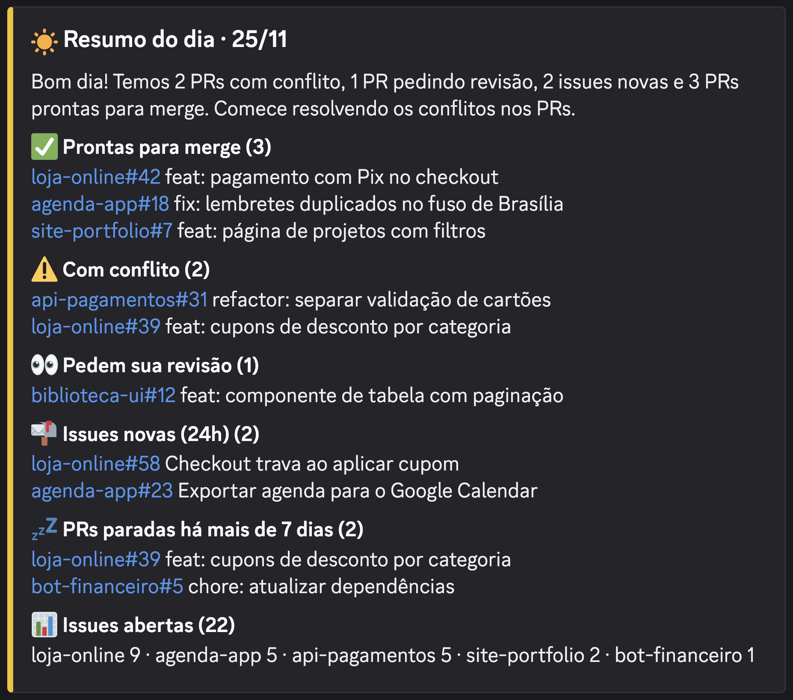
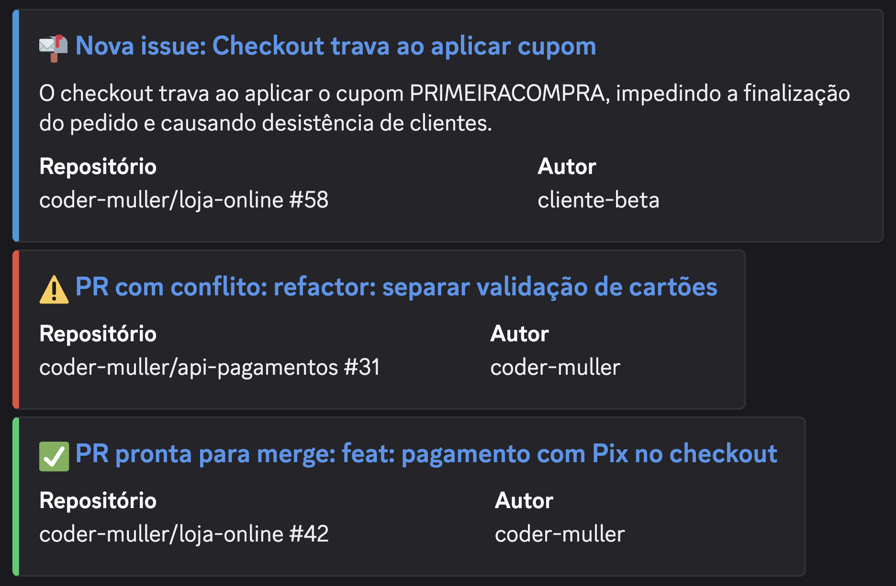

# Dev Digest

Um resumo do seu GitHub no Discord: toda manhã e sempre que algo muda.

<p align="center">
  
  
</p>

Todo dia, no horário que você escolher, chega uma mensagem com as PRs prontas para merge, as que têm conflito, as que estão paradas e os repositórios com mais issues abertas. Entre um resumo e outro, ele confere seus repositórios a cada poucos minutos e avisa quando uma issue nova é aberta, quando uma PR passa a ter conflito ou quando fica pronta para merge. Cada issue nova vem com uma frase escrita por IA explicando do que se trata.

Nasceu de um problema real: com 23 repositórios, 17 PRs e 64 issues abertas, saber o que precisava de atenção era abrir um por um, e um conflito só aparecia na hora do merge.

## Requisitos

- Python 3.11 ou mais recente
- Um token do GitHub, uma chave do [Vercel AI Gateway](https://vercel.com/ai-gateway) e um webhook do Discord

## Instalação

```bash
git clone https://github.com/coder-muller/dev-digest.git
cd dev-digest
python3 -m venv .venv
source .venv/bin/activate
pip install -r requirements.txt
cp .env.example .env
```

Depois preencha o `.env`:

- **`GITHUB_TOKEN`**: em Settings → Developer settings → Fine-grained tokens, com acesso a todos os repositórios e **Issues** e **Pull requests** como somente leitura.
- **`AI_GATEWAY_API_KEY`**: em AI Gateway → API Keys, no painel da Vercel. O plano gratuito basta.
- **`DISCORD_WEBHOOK_URL`**: no canal, em Editar canal → Integrações → Webhooks → Novo webhook → Copiar URL.

As outras variáveis são opcionais e estão explicadas no [`.env.example`](.env.example): o modelo de IA (padrão `google/gemini-2.5-flash`), o horário do resumo, o intervalo entre verificações e quais repositórios acompanhar.

## Uso

```bash
python -m dev_digest run      # fica rodando: verifica a cada 2 min e manda o resumo às 08:00
python -m dev_digest digest   # manda o resumo agora
python -m dev_digest check    # verifica uma vez
```

Na primeira verificação ele só guarda o estado atual, para não avisar como novas as issues que já existiam.

## Como funciona

```
agendador → GitHub API → analyzer → IA → Discord
                            ↕
                    data/state.json
```

A cada verificação, o Dev Digest busca as PRs e issues abertas na API REST do GitHub e compara com o que viu da última vez, salvo em `data/state.json`. Uma issue que não estava lá é nova. Uma PR cujo `mergeable_state` mudou para `dirty` ganhou conflito, e uma que mudou para `clean` ficou pronta. Só o que mudou vira mensagem.

Quem decide o que avisar é o código. A IA recebe os dados já organizados e só escreve o texto, por isso não tem como inventar uma PR. Se ela estiver fora do ar, a mensagem sai do mesmo jeito, com um texto padrão. Se o Discord falhar, o estado não é salvo e os avisos são reenviados na próxima verificação.

Usa `requests` para as três APIs (GitHub com Bearer token, Vercel AI Gateway e webhooks do Discord) e `python-dotenv` para ler as credenciais, que ficam só no `.env`.

```
dev_digest/
  __main__.py   comandos e agendador
  config.py     leitura do .env
  analyzer.py   compara com o estado anterior e monta o resumo
  state.py      salva o estado em data/state.json
  clients/      GitHub, IA e Discord
```

## Roadmap

- Perguntar coisas ao bot, como "quais PRs estão travadas?"
- Usar webhooks do GitHub no lugar das verificações periódicas

---

Projeto final de Automação e Programabilidade em Redes (UniSenac Pelotas, Prof. Wagner Loch), por Guilherme Coelho Müller e Arthur Ortiz Fonseca.

## Licença

[MIT](LICENSE)
